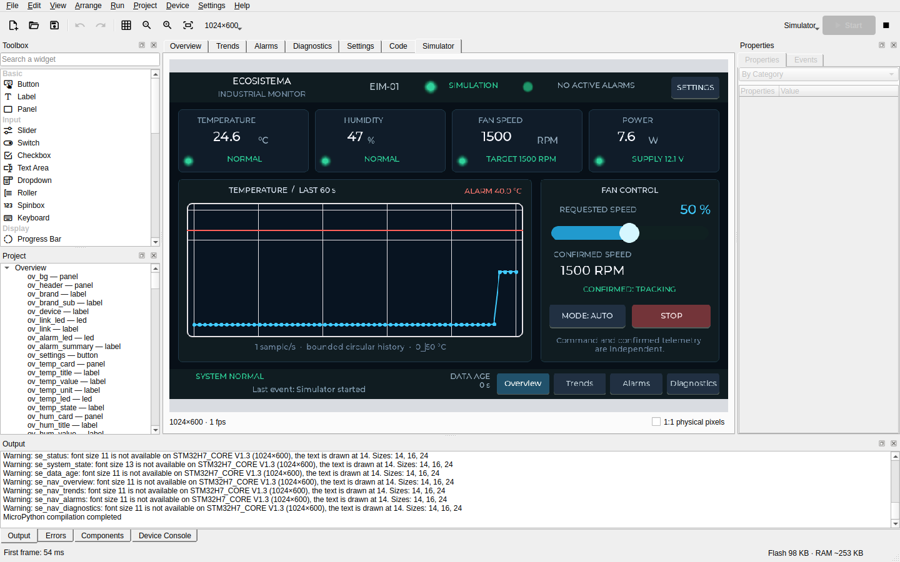

# LVGL MPY Studio

[](https://github.com/Copper-And-Code/lvgl-mpy-studio/actions/workflows/ci.yml)

[English](README.md)

### [Sito del progetto](https://copper-and-code.github.io/lvgl-mpy-studio/) · [Prova le demo nel browser](https://copper-and-code.github.io/lvgl-mpy-studio/demos/)

Il sito ha la documentazione (in inglese); le demo sono giochi e una shell fatti con LVGL MPY Studio, che girano in WebAssembly senza installare nulla.

Un IDE desktop per progettare interfacce [LVGL](https://lvgl.io) 9.5 per board MicroPython: disegni le pagine, scrivi i gestori in Python, esegui l'applicazione in un simulatore che usa la vera LVGL e la carichi su una board. Un agente AI può fare lo stesso attraverso un server MCP.



> **Stato: 0.7.0 ([scarica](https://github.com/Copper-And-Code/lvgl-mpy-studio/releases/latest)).** I test automatici sono molti e le prove fatte da persone sono poche: molto è stato scritto e verificato dalle macchine, e poco è stato usato davvero. [Cosa è verificato, e come](docs/status.md) lo dice area per area.

## Se stai valutando questo progetto

Queste pagine sono in inglese.

| | |
|---|---|
| [Lo stack](docs/stack.md) | Dai registri del controller del display allo strumento chiamato da un agente: sette livelli, due repository, e da dove cominciare a leggere. |
| [Come è stato costruito](docs/how-it-was-built.md) | Un ingegnere che dirige agenti AI: chi ha fatto cosa, il metodo, e perché la storia comincia dalla 0.5.0. |
| [Cosa è verificato](docs/status.md) | Ogni area rispetto a test, collaudo automatico e board vere; difetti noti; cosa manca. |
| [Caso d'uso](docs/case-study-eim-01.md) | Un monitor industriale di 5 pagine e 256 widget, costruito da un agente AI a partire da un prompt attraverso il server MCP, con i suoi limiti dichiarati. |
| [Decisioni](docs/decisions.md) | Il registro datato di cosa è stato scelto e perché. |

## Cosa fa

- **Un solo motore ovunque.** Board, simulatore, eseguibili per Linux e Windows e versione per il browser eseguono lo stesso MicroPython e lo stesso LVGL, compilati dagli stessi sorgenti e non emulati: ogni correzione e ogni miglioramento dei due progetti arriva a tutti insieme ([perché](docs/stack.md#one-engine-four-places-it-runs)).
- **Disegno.** Un designer con trascinamento che mostra la pagina come la disegna LVGL, alla risoluzione della board, con annulla, allineamenti e un cambio di risoluzione che adatta il layout.
- **Codice.** Gestori e moduli in Python, con completamento, azioni in chiaro che inseriscono la chiamata LVGL esatta, ed errori che portano al gestore e alla riga, anche quando avvengono sulla board.
- **Esecuzione.** Un simulatore con touch, tastiera e suono; caricamento sulla board in bytecode; modifiche grafiche mostrate sulla board in esecuzione poco dopo averle fatte.
- **Board.** Board ESP32-S3, RP2350 e STM32H743 con pannelli RGB, con il firmware costruito in [un repository a parte](https://github.com/Copper-And-Code/mpy-lvgl-boards).
- **Blocchi hardware.** Componenti come Uscita digitale e Ingresso digitale, descritti da una cartella di dati e codice MicroPython che [chiunque può scrivere](docs/blocks.md).
- **Risorse.** Immagini e font TrueType conservati nel progetto e convertiti per LVGL dall'IDE, kerning compreso, senza strumenti esterni.
- **Distribuzione.** Eseguibili a file unico per Linux e Windows, una versione che gira nel browser in WebAssembly, e sorgenti C portabili.
- **Agenti.** Un [server MCP](docs/mcp.md) con 49 strumenti: un agente disegna, renderizza, simula e carica. [Da un prompt a un'app](docs/mcp-demo.md) è una sessione registrata.
- **Verifica.** Test visivi di un progetto su un orologio simulato, e un [collaudo automatico](docs/manual.it.md#collaudo-automatico) in cui l'IDE si usa da solo con mouse e tastiera.

## Provalo

L'AppImage della [release](https://github.com/Copper-And-Code/lvgl-mpy-studio/releases/latest) richiede glibc 2.38 o successiva: Ubuntu 24.04, Debian 13, Fedora 39, Linux Mint 22 o più recenti.

Linux, dai sorgenti, con Python 3.12 o successivo:

```bash
python3 -m venv .venv
.venv/bin/pip install -e '.[dev]'
./runtime/build.sh
.venv/bin/lvgl-mpy-studio
```

Poi **File → Apri** e `examples/eim-01/project.json`, e F5. La lingua si cambia da **Impostazioni → Lingua**. Requisiti, Windows, pacchetti e suite di test sono in [Building, testing and packaging](docs/development.md).

Per vedere l'IDE usarsi da solo, con il rapporto di ogni passo:

```bash
.venv/bin/lvgl-mpy-studio selftest --show
```

## Documentazione

- [Manuale utente](docs/manual.it.md), [board](docs/boards.it.md), [pubblicare un gioco sul web](docs/publish-web.it.md)
- [Server MCP](docs/mcp.md), [scrivere un blocco](docs/blocks.md)
- [Compilazione e test](docs/development.md), [costruire i pacchetti](docs/packaging.md), [changelog](CHANGELOG.md)

## Limiti

Solo Linux e Windows x86-64. Il codice utente è Python: il C viene esportato come sorgenti, non caricato. Su Windows il pacchetto parte; poco altro è stato provato lì. I due blocchi hardware hanno girato su una sola board. L'elenco completo è nella [pagina dello stato](docs/status.md).

## Licenza

L'IDE è distribuito con licenza GPL-3.0-or-later. Il codice generato per i tuoi progetti e i componenti che l'IDE vi include sono sotto MIT, quindi i tuoi prodotti non diventano GPL. Vedi [LICENSING.md](LICENSING.md).

LVGL MPY Studio è un progetto indipendente, non affiliato a LVGL né da essa approvato. LVGL è un nome dei rispettivi titolari.
