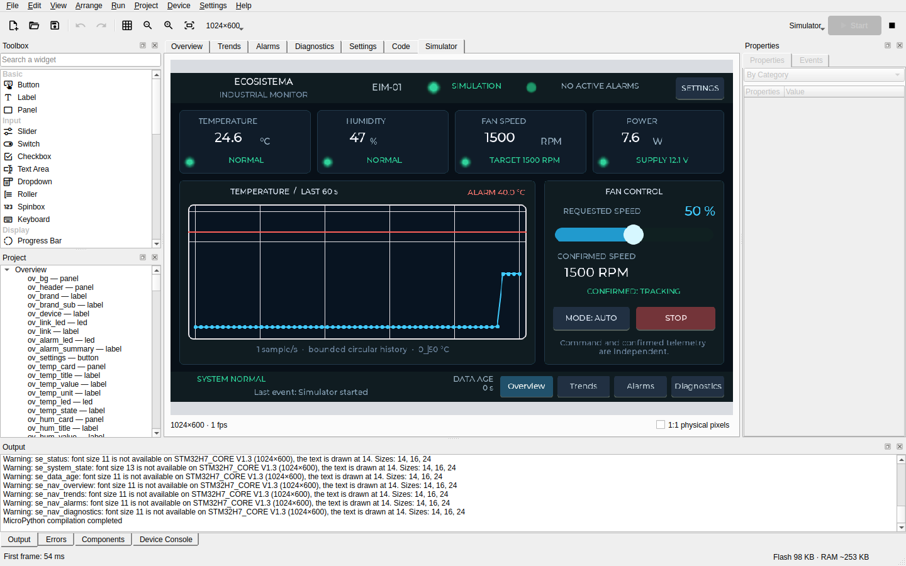

# LVGL MPY Studio

[Italiano](README.it.md)

A desktop IDE for designing [LVGL](https://lvgl.io) 9.5 interfaces for MicroPython boards: you draw the pages, write the handlers in Python, run the application in a simulator that uses the real LVGL, and upload it to a board. An AI agent can do the same through an MCP server.



> **Status: 0.6.0, in development, not released.** The automated tests are many and human testing is scarce: much has been written and checked by machine, and little has been used by people. [What is verified, and how](docs/status.md) says it area by area.

## If you are evaluating this project

| | |
|---|---|
| [The stack](docs/stack.md) | From the registers of the display controller to the tool an agent calls: seven layers, two repositories, and where to read first. |
| [How it was built](docs/how-it-was-built.md) | One engineer directing AI agents: who did what, the method, and why the history starts at 0.5.0. |
| [What is verified](docs/status.md) | Each area against tests, self-test and real boards; known defects; what is missing. |
| [Case study](docs/case-study-eim-01.md) | An industrial monitor of 5 pages and 256 widgets, built by an AI agent from a prompt through the MCP server, with its limits stated. |
| [Decisions](docs/decisions.md) | The dated record of what was chosen and why. |

## What it does

- **Design.** A drag and drop designer that shows the page as LVGL draws it, at the resolution of the board, with undo, alignment, and a resolution change that adapts the layout.
- **Code.** Handlers and modules in Python, with completion, plain-language actions that insert the exact LVGL call, and errors that lead to the handler and line, also when they happen on the board.
- **Run.** A simulator with touch, keyboard and sound; upload to a board as bytecode; changes to the design shown on the running board shortly after an edit.
- **Boards.** ESP32-S3, RP2350 and STM32H743 boards with RGB panels, through firmware built in [a repository of its own](https://github.com/Copper-And-Code/mpy-lvgl-boards).
- **Hardware blocks.** Components such as Digital Output and Digital Input, described by a folder of data and MicroPython code that [anyone can write](docs/blocks.md).
- **Assets.** Pictures and TrueType fonts stored in the project and converted for LVGL by the IDE, kerning included, with no external tool.
- **Distribute.** Single-file executables for Linux and Windows, a version that runs in the browser as WebAssembly, and portable C sources.
- **Agents.** An [MCP server](docs/mcp.md) with 49 tools: an agent designs, renders, simulates and uploads. [From a prompt to an app](docs/mcp-demo.md) is a recorded session.
- **Testing.** Visual tests of a project on a simulated clock, and a [self-test](docs/manual.md#self-test) in which the IDE drives itself with mouse and keyboard.

## Try it

Linux, from the sources:

```bash
python3 -m venv .venv
.venv/bin/pip install -e '.[dev]'
./runtime/build.sh
.venv/bin/lvgl-mpy-studio
```

Then **File → Open** and `examples/eim-01/project.json`, and F5. Requirements, Windows, packages and the test suite are in [Building, testing and packaging](docs/development.md).

To see the IDE use itself, with a report of each step:

```bash
.venv/bin/lvgl-mpy-studio selftest --show
```

## Documentation

- [User manual](docs/manual.md), [boards](docs/boards.md), [publishing a game on the web](docs/publish-web.md)
- [MCP server](docs/mcp.md), [writing a block](docs/blocks.md)
- [Building, testing and packaging](docs/development.md), [changelog](CHANGELOG.md), [roadmap](docs/roadmap.md)

## Limits

Linux and Windows x86-64 only. User code is Python: C is exported as sources, not uploaded. Windows has not been verified natively since a packaging defect was corrected. Of the hardware blocks only Digital Output has run on a board. The full list is in [the status page](docs/status.md).

## License

The IDE is licensed under GPL-3.0-or-later. Code generated for your projects and the components the IDE embeds in them are under MIT, so your products do not become GPL. See [LICENSING.md](LICENSING.md).

LVGL MPY Studio is an independent project, not affiliated with or endorsed by LVGL. LVGL is a name of its respective owners.
