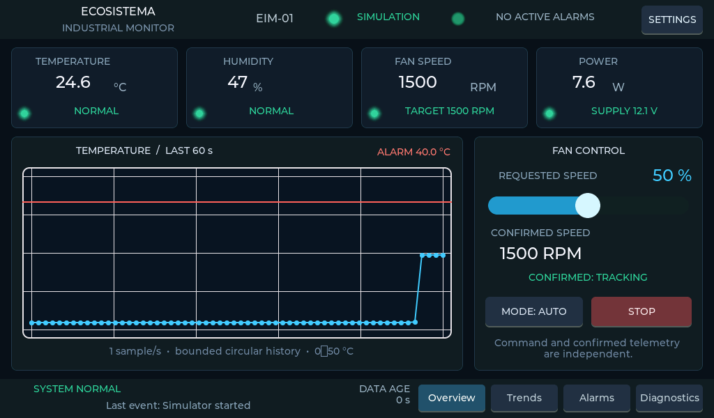
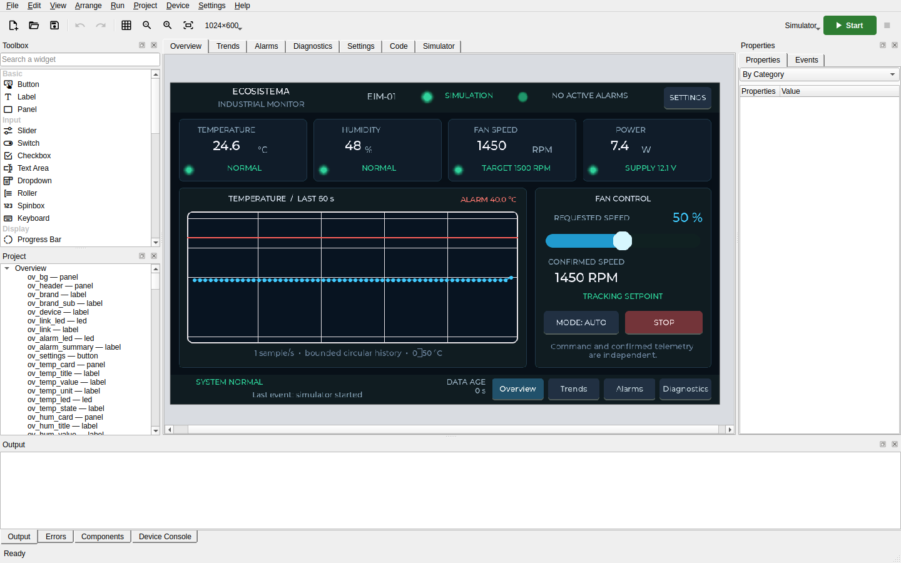

# Case study: EIM-01, an industrial monitor

EIM-01 is the largest application built with LVGL MPY Studio so far: an operator panel that
watches a temperature and controls a fan. It is in `examples/eim-01`, for a 1024×600 display,
and in `examples/eim-01-480` with a layout of its own for 480×480.

**It was built by an AI agent, from a prompt, through the [MCP server](mcp.md)**: the agent
created the project, placed the widgets, wrote the code, rendered the pages, played the
scenarios and recorded the visual tests with the same tools described in that guide. Nobody
drew it by hand in the designer. The checks listed below are the agent's own, and the result
has not been reviewed line by line by a person.



**What it is not.** There is no fan and no sensor: the values come from a simulation inside
the application, and it has not been run on a board. It shows what the tool can carry as an
application, not a finished device. The last section says what is missing to make it one.

## What it does

- **Overview**: temperature, humidity, fan speed and power; a temperature chart with the alarm
  threshold; the fan command, with the requested and the confirmed speed shown apart.
- **Trends**: history over 1, 5 and 15 minutes with minimum, maximum and average, and a pause
  that stops the scrolling while the acquisition goes on.
- **Alarms**: a list with the states active, acknowledged and cleared.
- **Diagnostics**: link state, age of the data, sequence number, uptime, free memory.
- **Settings**: thresholds, refresh rate, data source, and the scenario to simulate.

Five scenarios drive it: normal operation, a temperature that climbs past the threshold, a
fan that stalls while its command stays the same, a link that is lost for twelve seconds and
comes back, and the recovery to normal values.



## Size

| | |
|---|---|
| Pages | 5 |
| Widgets and timers | 256 |
| Handlers | 48 |
| General code | about 500 lines of MicroPython |
| Generated application for the STM32H7 board | 7 files |

The interface is made of widgets of the project, the same a person places in the designer,
not of objects created by code. The logic is in the general code and
in the handlers, apart from the code that creates the screens: ring buffers limited to 900
samples, validation of each value received, the alarm states, the fan ramp.

## How it was checked

- **In the simulator**, by the agent, through a list of cases it recorded when it made the
  example: page changes, the fan ramp from
  1500 to 2400 RPM at an 80% command, the alarm above 40 °C and its acknowledgement while the
  condition lasts, the stalled fan, the lost link and the automatic recovery, a missing value
  shown as N/A.
- **By visual tests** that anyone can repeat. Three scenarios are stored with the project and
  replayed on a simulated clock, so that every run is the same:

  ```bash
  lvgl-mpy-studio test examples/eim-01/project.json
  ```

  It makes 17 comparisons between pages and scenarios, to the pixel.
- **By generating** the application for the STM32H7_CORE board and, in the 480×480 version,
  for the ESP32-4848S040.

## What bringing it to version 0.6 showed

The example was made with version 0.4. Opening it again with 0.6 gave two findings, both
left visible:

- **Font sizes the board lacks.** Several labels use sizes 11 and 13, which the firmware of
  the STM32H7 board does not have: they are drawn at 14. Version 0.4 said nothing; 0.6 lists
  each one as a warning.
- **A reference image with a changing value.** The Diagnostics page shows the free memory,
  which changed with the new generator: one of the 17 comparisons failed until the image was
  regenerated. A page under visual test should not show such a value.

## What is missing to make it a device

0. **A person's review.** The application was written and checked by an agent. It reads well
   and its tests pass, but its alarm logic and its limits have not been examined by an engineer
   as a real panel would require.

1. **Hardware.** Run it on the STM32H7_CORE board, where it has never been uploaded.
2. **A real temperature and a real fan.** The data source can be set to TCP, serial or BLE in
   the interface, but only the simulation is implemented.
3. **Blocks for the hardware.** A temperature sensor on I2C and a fan on PWM are the blocks
   planned for LVGL MPY Studio and not written yet; this example is their first user.
4. **Settings that survive a restart**: today they are kept in RAM only.
