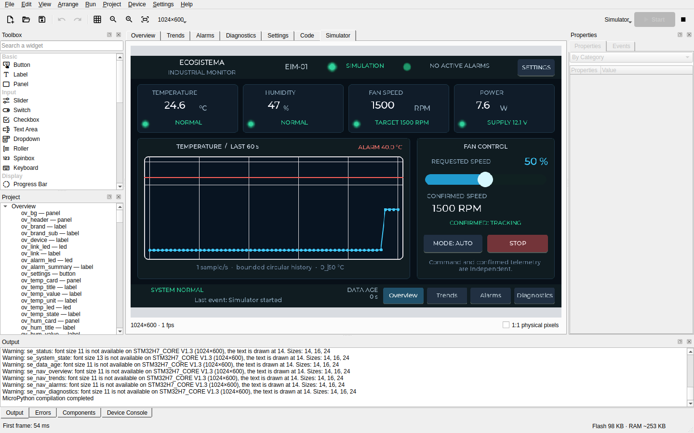

# LVGL MPY Studio

LVGL MPY Studio is a desktop IDE for building graphical interfaces with LVGL 9.5 and MicroPython. Design pages visually, write event handlers in Python, and run the application in a simulator that uses the real LVGL library.

The same project can be uploaded to a supported board, exported as portable C sources, built as a standalone application, or published in the browser through WebAssembly. AI agents can perform the complete workflow through the MCP server.

> **Status: 0.6.0, no packages published yet.** The automated tests are many and human testing is scarce: much has been written and checked by machine, and little has been used by people. [What is verified, and how](status.md) describes each area.

## Documentation

Install the IDE, create the first project, and learn how to publish it.

[Getting started](getting-started.md){ .md-button .md-button--primary }
[User manual](manual.md){ .md-button }

## Browser demos

Try applications and games built with LVGL MPY Studio, running on a shared WebAssembly runtime.

[Open the gallery](demos.md){ .md-button .md-button--primary }

## Project evaluation

Examine the architecture, development method, recorded decisions, and current verification limits.

[The stack](stack.md){ .md-button .md-button--primary }
[What is verified](status.md){ .md-button }

